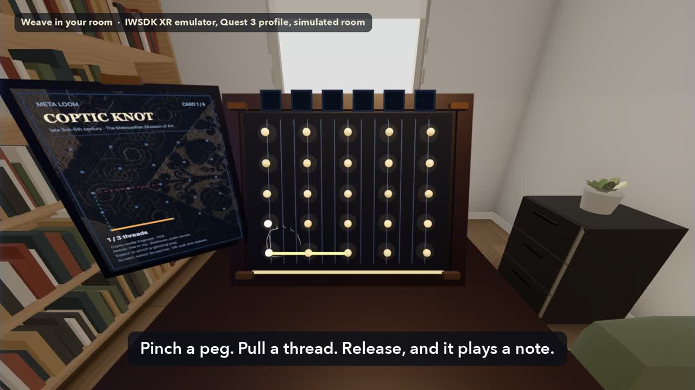
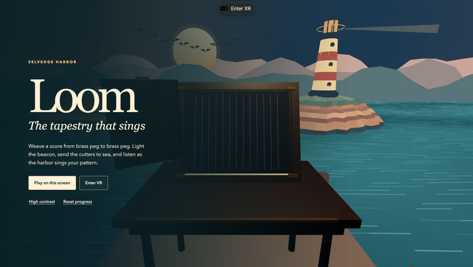
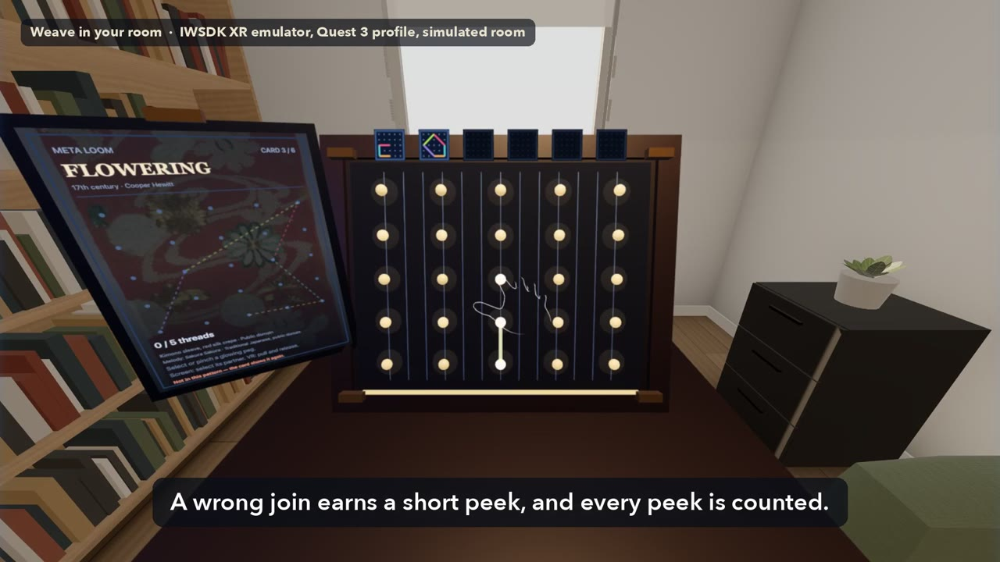
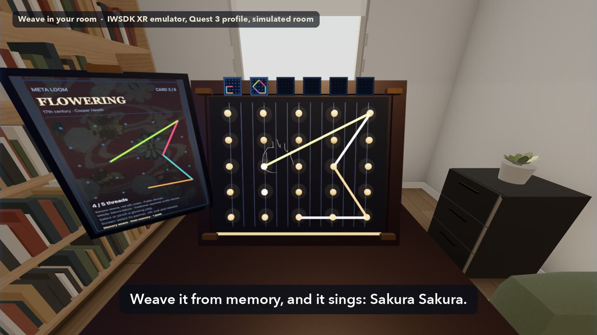
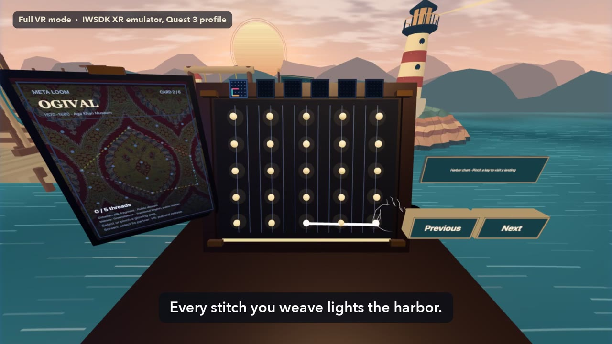
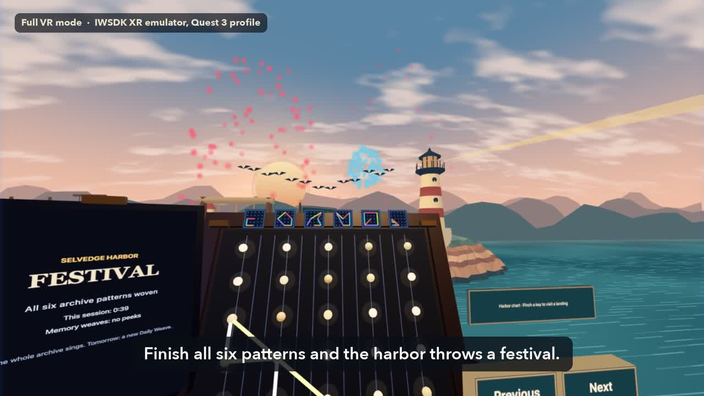
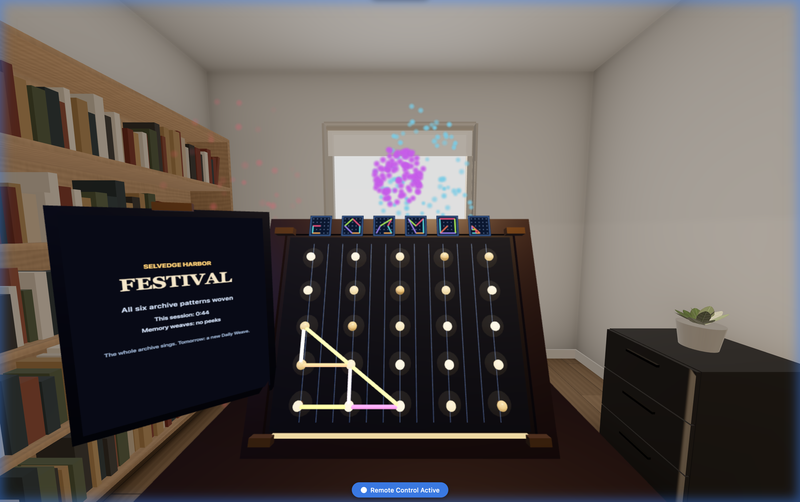
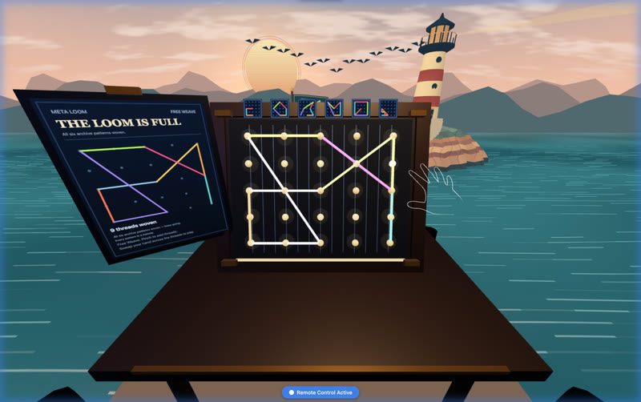
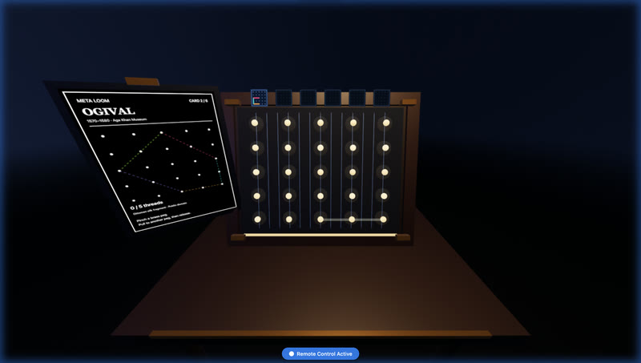
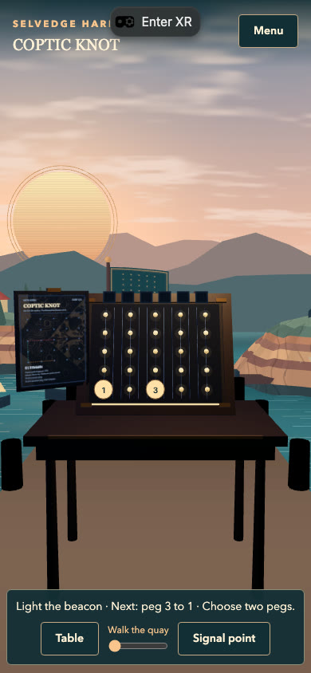

# Loom: The Tapestry That Sings

**A seated, hands-only weaving game for Meta Quest: pinch glowing threads between brass pegs, in your own room or on a sunset harbor, and the pattern you weave plays back as music.**

[Play it now](https://loom-meta-vr.pages.dev) · Watch the 2:33 demo (the YouTube link is on the Devpost page) · No install, no account, free



> Built for the **Meta VR Start Developer Competition 2026**, in the **Gaming** track, **New Experience** division. Built with the Immersive Web SDK (IWSDK) 1.1. The project was started on 17 Nov 2026.

## The problem

Most VR games ask for standing room, controllers and a long tutorial. Many headset moments don't come with any of that: you're seated on a sofa, at a desk or in a plane seat, you have five spare minutes, and only your hands are free. Hand tracking is at its best on precise, close-range gestures, but few games are built around a single gesture that feels good on its own.

## Our solution

Loom is built around one gesture: **pinch, pull, release**. A walnut loom with 25 brass pegs sits within arm's reach. You pinch a peg, pull a glowing thread to its partner peg and let go. The thread snaps into place and plays the next note of the pattern's melody. When the pattern is finished, the whole tapestry plays the tune back.

### What makes it different

- **The tapestry is the score.** Every stitch is a note, so a finished pattern is a song you made with your hands.
- **Real cultural material.** Each of the six cards is an original peg pattern based on a dated, public-domain museum textile, which is shown and credited on the card, and each is paired with a public-domain melody.
- **Two places to play the same loom.** In *Weave in your room*, an `immersive-ar` passthrough session, only the loom is drawn and your real room stays around it. In *Enter VR*, an `immersive-vr` session, the loom sits on the quay of Selvedge Harbor, and the harbor reacts to your weaving.

## See it in action



| Finish a card and the tapestry sings | Memory weave: a wrong join earns a peek | Woven from memory: *Sakura Sakura* |
|---|---|---|
|  |  |  |

| VR: every stitch lights the harbor | Finale in VR: the Harbor Festival | Finale in your room |
|---|---|---|
|  |  |  |

| Free Weave: strum the finished threads | High-contrast mode | Phone, portrait |
|---|---|---|
|  |  |  |

*All screenshots come from the IWSDK XR emulator (Quest 3 profile) or a desktop browser. The room is the emulator's simulated room.*

### Try the main flow (2 minutes)

1. Open https://loom-meta-vr.pages.dev in Meta Quest Browser and choose **Weave in your room** or **Enter VR**. On a laptop or phone, choose **Play on this screen**.
2. Pinch the glowing peg and follow the ghost thread to its partner. Each join plays one note.
3. Join the wrong pair on purpose. The thread is rejected, and the ghost thread shows you the right partner.
4. Finish the card. The tapestry plays *Ode to Joy* and the card shows **WOVEN**.
5. Reload the page. Your progress is still there.

**Expected outcome:** a stitch and a note within seconds of starting, a full pattern in under two minutes, no controller, and no fail state.

## Key features

### 1. Musical weaving
- **What it does:** each correct join plays the next note of the card's melody, and a completed card plays the whole melody.
- **Why it matters:** every action gives you sound back straight away, so the game teaches itself.
- **Implementation:** notes are synthesised with Web Audio, in [`src/loom.ts`](src/loom.ts).

### 2. Memory weave puzzle (cards 3–6)
- **What it does:** the pattern shows on the card for 6 seconds and then fades. You weave it back from memory. A wrong join earns a 2.5-second peek, and every peek is counted.
- **Why it matters:** the gesture becomes a real challenge without adding a fail state. If you stall for 12 seconds, the ghost thread comes back.
- **Implementation:** the `memoryPreview`, `memoryPeek` and `memoryPeeks` state in [`src/loom.ts`](src/loom.ts).

### 3. Two play spaces
- **What it does:** room mode uses passthrough and hides the harbor, the floor and the sky dome. VR mode shows Selvedge Harbor, where stitches light the lighthouse beacon and the village windows, send pilot cutters out to sea and call the terns home.
- **Why it matters:** it fits both a quick seated session in the player's own space and a longer, more immersive one.
- **Implementation:** [`src/mixed-reality.ts`](src/mixed-reality.ts) and [`src/harbor.ts`](src/harbor.ts).

### 4. A complete arc and reasons to return
- **What it does:**
  - six archive cards;
  - a **Harbor Festival** finale with fireworks, the returning terns and a medley of all six melodies;
  - a date-seeded **Daily Weave** with a streak;
  - **Free Weave**, where you strum the finished threads like a harp.
- **Implementation:** [`src/festival.ts`](src/festival.ts), a pooled particle system that allocates nothing per frame.

### 5. Accessibility
- **What it does:**
  - works with either hand;
  - widens the peg targets for 8 seconds after two missed releases;
  - offers a high-contrast mode;
  - everything stays seated and within reach, with no locomotion;
  - falls back to controllers only if hand tracking is unavailable.

## How it works

1. **Input:** the IWSDK hand-tracking poses feed the game loop, and the index fingertip is the authoritative point. A pinch selects the peg nearest the fingertip, the thread follows the hand, and the release is tested against valid partner pegs.
2. **Game state:** the `Loom` system in [`src/loom.ts`](src/loom.ts) tracks the card, the drawn and required edges, memory and peek timers, the celebration and the festival. It publishes this state on a `LoomStatus` ECS entity.
3. **World reactions:** [`src/harbor.ts`](src/harbor.ts) maps stitch progress to the beacon, windows, sails and terns.
4. **Session modes:** [`src/mixed-reality.ts`](src/mixed-reality.ts) reads the session's `environmentBlendMode`. In passthrough it hides the environment nodes and clears the background to transparent, and it restores them when the session ends.
5. **Persistence:** progress, best times and streaks are saved in `localStorage` on the device.

### Technology stack

| Layer | Technology | Why |
|---|---|---|
| XR runtime | Immersive Web SDK 1.1 (WebXR, ECS) | Hands, sessions and the emulator are built in, and the game ships as a URL |
| Rendering | Three.js (re-exported by `@iwsdk/core`) | Procedural geometry and shader water, so there are no model downloads |
| Audio | Web Audio API | Every note is synthesised at runtime |
| Language / build | TypeScript 5, Vite | Typechecked and built as a static bundle |
| Hosting | Cloudflare Pages | Free HTTPS URL that judges can open on a headset |

### Technical decisions

- **WebXR instead of a native APK.** Judges can open a link and play straight away, with no sideloading. The trade-off is that browser performance is less predictable, so the game uses procedural assets and allocates nothing per frame.
- **Procedural everything.** Apart from the six archive photographs, all geometry, textures and audio are generated at runtime. That keeps the bundle at about 2.5 MB, and the page loads in about 0.4 s on a desktop connection.
- **One gesture, no menu screens.** Navigation stays at the loom, using the **Previous** and **Next** buttons beside the board, which you press with the same pinch, so your hands never leave the play space.

## Competition fit

| Competition requirement | How Loom meets it |
|---|---|
| Fully usable with hands, no controller pairing | The entire game is pinch, pull, release |
| Seated, stationary, within about two feet | There is no locomotion, and every peg is within arm's reach |
| Fast cold start, satisfying in under 10 minutes | First note within seconds; a card takes under 2 minutes |
| Original core experience | Weaving as musical composition, using real archive textiles |
| Playable build | https://loom-meta-vr.pages.dev |

## Results and validation

All results below come from the IWSDK XR emulator (Quest 3 profile) and automated browser checks run on 18 Nov 2026.

| Check | Result |
|---|---|
| Public site check, desktop and portrait touch | Visits all 9 harbor stops; a wrong join is rejected, the retry works, the card reaches WOVEN, and progress survives a reload. 0 console errors, 0 HTTP errors |
| Memory weave on the public site | WOVEN "from memory, 1 peek", 0 errors |
| Room mode → festival → exit → VR | The festival fires in both modes, nothing from the harbor appears in the room, and the harbor is restored in VR |
| Build | `npm run typecheck` and `npm run build` pass |
| Demo video | 1080p30, 2:33, recorded in the emulator |

## Technical challenges

**Challenge 1: recording room mode.** The emulator draws the simulated room on a separate canvas behind the game canvas, so recording the game canvas alone gave blank backgrounds.
**Resolution:** the whole page was recorded with a Chrome DevTools Protocol screencast, and the audio was captured with an in-page Web Audio tap.

**Challenge 2: the harbor went missing after switching from room mode to VR.** The passthrough setup ran twice and saved the already-hidden state, so restoring it hid the harbor again.
**Resolution:** the setup now guards against running twice.

**Challenge 3: the answer leaked during a peek.** During a memory peek, the desktop footer showed the next peg pair.
**Resolution:** while a memory card is hidden, the footer shows "Weave it from memory" instead.

## Getting started

```bash
npm install
npm run dev        # IWSDK-managed dev server + XR emulator
npm run typecheck
npm run build      # static bundle in dist/
npm run preview
```

Requires Node 20.19 or later. No environment variables or API keys are needed.

## Current limitations

- Tested in the IWSDK XR emulator. The frame rate on a physical Quest has not been measured.
- The room-mode footage uses the emulator's simulated room, not real on-device passthrough.
- Not tested on Meta VR Glasses, and no support for them is claimed.

## What's next

1. Measure performance on a physical Quest and tune it.
2. Anchor the loom to a real table detected in the room.
3. Add more archive cards through museum partnerships, two-player cooperative patterns, and a shareable snapshot of each finished tapestry.

## Credits and disclosures

- The textile images are public-domain works with their sources listed on each card; see [ARCHIVE.md](ARCHIVE.md).
- The melodies (*Ode to Joy*, *Greensleeves*, *Sakura Sakura*, *La Folia*, *Amazing Grace*, an Andean pentatonic tune) are public domain and synthesised at runtime.
- Built with the Immersive Web SDK and Three.js.
- AI coding assistants were used during development.
